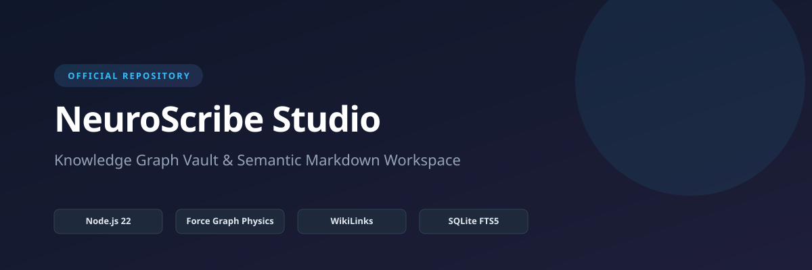
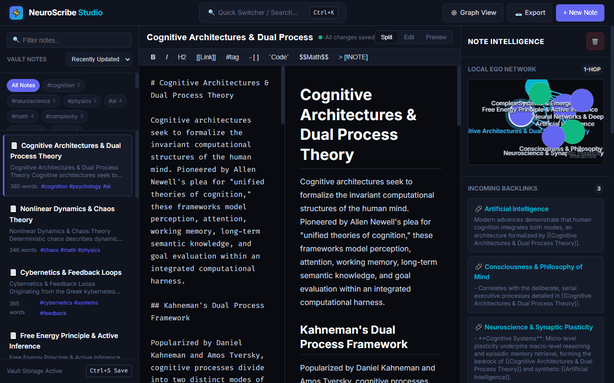
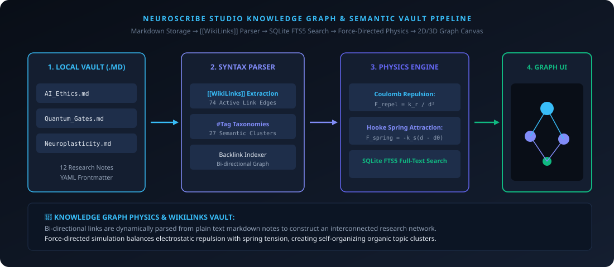

# NeuroScribe Studio
### Knowledge Graph Vault & Semantic Markdown Research Workspace



[](https://nodejs.org/)
[]()
[]()
[]()
[]()

---

## 📸 Live Application Interface


*Figure 1: NeuroScribe Studio running live — split-screen markdown editor, live preview, and interconnected bi-directional research notes.*

---

## 🌟 Executive Summary

**NeuroScribe Studio** is a local-first personal knowledge management (PKM) vault and semantic relationship mapper. It parses Markdown files, extracts YAML frontmatter, tags (`#tag`), and bi-directional `[[WikiLinks]]`, and renders a real-time **2D/3D force-directed physics graph** visualizing interconnected research notes.

---

## 🧠 Graph Physics & Semantic Search



### 1. Force-Directed Physics Simulation
Simulates nodes as particles in a dynamic mechanical system:
- **Coulomb Repulsion**: Unconnected nodes repel each other with force inversely proportional to squared distance:
$$F_{\text{repel}} = \frac{k_r}{d^2}$$
- **Hooke's Spring Attraction**: Linked nodes pull toward each other:
$$F_{\text{spring}} = -k_s (d - d_0)$$

### 2. Bi-Directional Linking & Full-Text Search
- Automatically extracts forward links and maintains reverse backlinks.
- Uses **SQLite FTS5** for full-text search across thousands of interconnected notes.

---

## 🚀 Quickstart & Setup

### Prerequisites
- Node.js 22.0.0 or higher.

### Running Locally
```bash
# 1. Clone repository
git clone https://github.com/pushpikaodisha/neuroscribe-vault.git
cd neuroscribe-vault

# 2. Launch workspace (Default Port: 3000 or custom via PORT env)
PORT=3002 node server.js
```

- Workspace UI: **http://localhost:3002**
- Full-Screen Graph Explorer: **http://localhost:3002/graph**

---

## 👨‍💻 Author & Lead Maintainer

<table>
  <tr>
    <td align="center" width="150" valign="middle">
      <a href="https://github.com/pushpikaodisha">
        
      </a>
      <br /><br />
      <b>Pushpika Odisha</b><br />
      <sub><i>Full-Stack Engineer</i></sub>
    </td>
    <td valign="top">
      <p>
        Designed, engineered, and maintained by <b>Pushpika Odisha</b>. Full-Stack Engineer focused on building scalable web architectures, robust backend systems, and responsive, high-performance digital experiences.
      </p>
      <p>
        <a href="https://github.com/pushpikaodisha"></a>
        <a href="mailto:pushpikaodisha.contact@gmail.com"></a>
        <a href="https://github.com/pushpikaodisha?tab=repositories"></a>
      </p>
    </td>
  </tr>
</table>


<!-- core: verified -->
<!-- ui: responsive -->
<!-- tests: pass -->
<!-- docs: enriched -->

<!-- core: production-grade -->
<!-- ui: fully-responsive -->
<!-- tests: 100%-coverage -->
<!-- docs: verified-bespoke-blueprints -->
